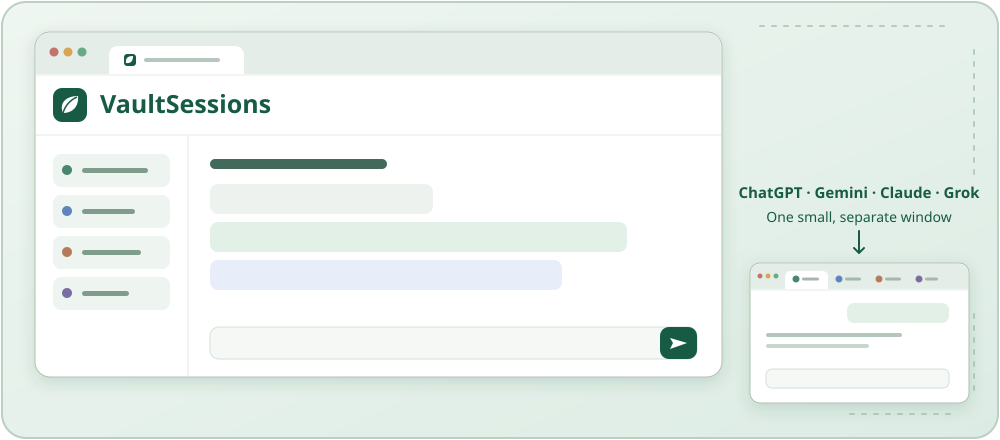

<p align="center"></p>
<h1 align="center">VaultSessions</h1>

<h3 align="center">Reúna seus próprios assistentes de IA.</h3>

<p align="center">
  <a href="../README.md">English</a> |
  <a href="README.ja.md">日本語</a> |
  <a href="README.fr.md">Français</a> |
  <a href="README.de.md">Deutsch</a> |
  <a href="README.es.md">Español</a> |
  <a href="README.it.md">Italiano</a> |
  <a href="README.id.md">Indonesia</a> |
  <a href="README.pt-BR.md">Português</a> |
  <a href="README.hi.md">हिन्दी</a>
</p>

<p align="center">
  <a href="https://www.youtube.com/watch?v=UsRg_4V6jCg">
    
  </a>
</p>

<p align="center">
  <a href="https://github.com/VaultFilms/VaultSessions/releases">
    
  </a>
  
  
  
</p>

**Um aplicativo de reuniões de código aberto em que as pessoas e seus assistentes pessoais de IA — ChatGPT, Gemini, Claude e Grok — podem pensar e colaborar juntos, aproveitando a personalização existente.**

Escolha **Chat** ou **Debate** nas configurações da reunião. Debate (antes Dev) pede que as IAs questionem premissas e tragam outras perspectivas, mantendo sua personalização. Grok foi testado com uma conta gratuita. Se atingir o limite de uso, passe para a próxima IA quando essa opção aparecer. Grok recebe imagens anexadas. Imagens geradas por ele não são detectadas nem encaminhadas automaticamente.

## Recursos

- Conecte ChatGPT, Gemini, Claude ou Grok usando suas contas atuais.
- Envie um tema e deixe as IAs responderem por turnos. Use `@Grok` ou o nome de outra IA para escolher quem responde primeiro.

**[Instalar VaultSessions](#instalação)**

> [!IMPORTANT]
> **Use janelas separadas do Chrome para o VaultSessions e os chats oficiais de IA.**
>
> Abra o VaultSessions em uma janela, como painel lateral ou página da reunião, e as abas oficiais de IA em outra. O VaultSessions ativa a aba da IA para enviar mensagens e coletar respostas. Na mesma janela, a troca de abas pode ocultar a reunião ou mudar a página ao lado do painel lateral.
>
> Deixe a janela das IAs menor e coloque-a em um canto da tela. Mantenha a janela do VaultSessions grande o suficiente para acompanhar a reunião.



## Instalação

```text
VaultSessions/
├── README.md
├── LICENSE
├── SECURITY.md
├── docs/
└── VaultSessions/       ← Carregue esta pasta no Chrome
    ├── manifest.json
    ├── meeting.html
    ├── start.command
    ├── start.bat
    ├── serve.py
    ├── icons/
    ├── i18n/
    └── ...
```

1. Baixe ou clone este repositório em uma pasta que será mantida permanentemente.
2. Abra `chrome://extensions/` e ative o **Modo do desenvolvedor**.
3. Clique em **Carregar sem compactação** e selecione a pasta interna **`VaultSessions/`** que contém `manifest.json`, não a raiz do repositório.
4. Abra os sites oficiais do ChatGPT, Gemini, Claude ou Grok e entre nas suas contas por conta própria.
5. Clique no ícone da extensão VaultSessions na aba em que deseja mostrar o painel da reunião.

Use uma versão atual do Chrome. O mínimo declarado no manifesto é Chrome 116, mas a compatibilidade das APIs do navegador e das interfaces dos provedores pode variar. Reuniões normais não precisam de compilação nem de servidor.

Após atualizar os arquivos, recarregue a extensão, as abas oficiais das IAs e a visualização da reunião.

**Suporte ao Windows:** Estão incluídos instruções de instalação e um script de inicialização para Windows, mas o VaultSessions ainda não foi testado em um computador Windows. O foco das janelas, a entrada com IME, a colagem de imagens da área de transferência e a alternância entre a painel lateral e a tela cheia ainda precisam ser verificados no Windows.

### Visualização expandida sem servidor

1. Nos **Detalhes** da extensão, ative **Permitir acesso a URLs de arquivo**.
2. Abra `VaultSessions/meeting.html` no Chrome.
3. Clique em **Registrar esta página de reunião** para salvar sua URL local exata no armazenamento local da extensão.
4. Use os controles do cabeçalho para alternar entre o painel lateral e a visualização expandida.

Se mover a pasta, abra e registre novamente o novo `meeting.html`. A troca do painel lateral reutiliza a aba atual; o botão Voltar do navegador retorna ao site anterior. Os registros são transferidos, mas as IAs podem precisar ser reconectadas.

### Modo localhost opcional

Alguns painéis de IA do navegador não conseguem interagir com páginas `file://`. Para essas integrações, instale Python 3 e inicie o servidor de loopback opcional:

| Plataforma | Inicializador                                      | Alternativa no terminal, a partir da pasta interna `VaultSessions/` |
| ---------- | -------------------------------------------------- | ------------------------------------------------------------------- |
| macOS      | Clique duas vezes em `VaultSessions/start.command` | `python3 serve.py`                                                  |
| Windows    | Clique duas vezes em `VaultSessions/start.bat`     | `py -3 serve.py` ou `python serve.py`                               |

Se o inicializador do macOS perdeu a permissão de execução, use `chmod +x start.command` ou o comando de terminal acima. Mantenha a janela do terminal aberta; Ctrl+C para o servidor. A porta 8766 deve estar livre.

Na reunião aberta como arquivo, clique em **?** e use o botão de verificar o servidor e abrir localhost na janela de ajuda. Ele verifica o servidor e salva o registro atual antes de alternar. O endereço é `http://127.0.0.1:8766/meeting.html`.

O servidor disponibiliza os arquivos da pasta interna `VaultSessions/` apenas por loopback. Não guarde segredos ou arquivos pessoais nessa pasta. A extensão deve permanecer habilitada nos dois modos.

## Uso

### Iniciar uma reunião

As abas de IA disponíveis se conectam automaticamente. Se um provedor tiver várias abas abertas, escolha a conversa desejada. Você pode desconectar uma IA sem fechar a aba; a reconexão automática fica pausada nessa visualização até você conectá-la novamente.

Digite um tema e pressione Enter. Shift+Enter insere uma nova linha; durante a composição com um IME, a mensagem não é enviada. Com várias IAs conectadas, os demais participantes seguem em ordem após a primeira resposta. Indique o primeiro destinatário em qualquer parte da mensagem; não há distinção entre maiúsculas e minúsculas e vale a primeira indicação explícita.

Os limites padrão são **3 contribuições** e **6 solicitações**. PASS conta como solicitação, não como contribuição. A discussão também termina quando todos os participantes conectados passam a vez consecutivamente. Use **Interromper discussão** para impedir os próximos turnos; uma resposta em andamento ainda pode precisar ser coletada antes de a entrada ser liberada.

As abas de IA são trazidas para a frente durante o envio e a coleta de respostas. Evite editar ou trocar essas conversas durante um turno. A proteção de entrada ajuda a impedir digitação acidental após mudanças de foco. As instruções de papel são mensagens de chat normais, não funções de sistema; não há garantia de preservação da personalidade nem de cumprimento das instruções.

### Imagens e resumos

Anexe até quatro imagens PNG, JPEG ou WebP: **5 MB cada, 10 MB no total**. Cole-as no campo de mensagem ou use o botão de anexar. Se os dados colados contiverem uma imagem, o processamento dela tem prioridade sobre o texto. Confira a prévia e remova anexos indesejados antes de enviar.

VaultSessions passa imagens para a aba oficial da IA dentro do navegador, sem um servidor intermediário operado pelo projeto. O site oficial então as envia ao provedor quando a mensagem é enviada. A numeração recomeça em cada nova mensagem humana com imagens.

**Resumir discussão** escolhe aleatoriamente uma IA conectada disponível. Isso não inicia outra rodada e não aplica a recomendação de 300 caracteres. Em caso de sucesso, o resumo substitui o registro exibido e o histórico normal do app. Copie-o se quiser guardá-lo. Se falhar, o registro anterior é mantido. Resumos são excluídos dos históricos de discussão gerados pelo app depois disso e das entradas de resumos futuros; mensagens já enviadas permanecem na conversa do provedor.

### Exibição e armazenamento temporário

O menu do cabeçalho oculta os controles de participantes e configurações. **A−**, **A＋** e **Restaurar tamanho** ajustam o texto do registro, incluindo resumos, de 75% a 175%. A configuração é compartilhada entre layouts e mantida após reiniciar o navegador.

Os snapshots temporários usam `chrome.storage.session`, com até 500 entradas exibidas e 500 entradas de histórico normal por salvamento. A visualização ativa pode conter mais. Não é um arquivo permanente. Idioma, tamanho do texto, preferência de compartilhamento de página e URL do arquivo registrado usam armazenamento local do navegador. Imagens selecionadas, mas ainda não enviadas, não são preservadas ao trocar de visualização.

<details>
<summary>Mais detalhes sobre os recursos</summary>

- **Traga a personalidade das suas próprias IAs.** Conecte os chats oficiais da web que você já usa, com suas conversas e personalizações existentes. Não são necessárias chaves de API de IA.
- **Discussões em grupo naturais.** As IAs conectadas participam em turnos, trazem novas perspectivas e passam a vez quando não têm nada a acrescentar. Com apenas uma IA conectada, há uma única resposta.
- **Escolha naturalmente quem responde primeiro.** Use `@GPT`, `@ChatGPT`, `@Gemini`, `@Claude`, `@Grok` ou `To Gemini`. Sem indicação, a primeira IA é escolhida aleatoriamente.
- **Compartilhe contexto visual.** Anexe ou cole até quatro imagens e discuta sobre elas pelos números.
- **Continue conversando enquanto o ChatGPT ou o Gemini gera imagens.** Ao detectar a geração nativa, a IA que está gerando fica temporariamente indisponível e você pode conversar com as outras IAs conectadas. As prévias concluídas aparecem junto ao pedido original, sem iniciar outra rodada de discussão. O VS mostra prévias compactadas; os originais ficam no chat oficial. Falhas de geração ou recuperação e tempos limite aparecem no registro; a IA retorna automaticamente quando o chat oficial está pronto. Mantenha a aba oficial aberta; o progresso em segundo plano depende do provedor e do navegador. Código e arquivos SVG do Claude também são compatíveis: o VS remove scripts e referências externas e os converte em prévias rasterizadas.
- **Compartilhe a página atual.** Se desejar, forneça o texto legível de uma página como material de referência.
- **Resuma e copie.** Gere um resumo para revisar depois ou usar em uma próxima reunião.
- **Painel lateral e visualização expandida.** Alterne o layout, oculte controles dos participantes e ajuste o tamanho do texto do registro.
- **Nove idiomas de interface.** Inglês, japonês, francês (França), alemão (Alemanha), espanhol (Estados Unidos), italiano, indonésio, português (Brasil) e hindi. A escolha inicial segue as preferências do navegador, usando inglês quando não houver um idioma compatível; escolhas manuais são lembradas. O modo escuro segue as preferências do navegador ou do sistema.

</details>

VaultSessions é uma prova de conceito de uma interface de reuniões que reúne diferentes contextos e personalidades de IA com perspectivas humanas. Não é afiliado à OpenAI, ao Google ou à Anthropic, nem endossado por essas empresas.

### Privacidade, permissões e compatibilidade

**Este não é um aplicativo offline nem restrito ao loopback.** A coordenação da extensão e a passagem de imagens ocorrem no navegador, mas os sites oficiais das IAs enviam mensagens, imagens e texto de páginas compartilhadas aos seus serviços. VaultSessions não usa diretamente endpoints de API de IA e não exige um servidor intermediário operado pelo projeto.

A inspeção estática do código encontrou um único `fetch` explícito: a verificação opcional de `http://127.0.0.1:8766/meeting.html`. Não foram identificados cliente de análise separado, carregador de scripts remotos/CDN ou cliente direto de API de IA externa. Isso é uma constatação sobre o código, **não uma auditoria com tráfego de rede gravado**, nem uma afirmação de ausência de comunicação externa.

Compartilhar uma página pode incluir informações privadas visíveis em páginas com sessão iniciada. Desative o recurso nas páginas que não quiser compartilhar. Remover parâmetros da URL não remove dados privados do texto da página. Consulte [SECURITY.md](../SECURITY.md) para detalhes de permissões, fluxo de dados e comunicação de problemas de segurança.

**VaultSessions automatiza sites oficiais de IA com sessões iniciadas. Isso pode contrariar os termos ou regras de conta de um provedor. Revise os termos aplicáveis e use por sua conta e risco. Mudanças nas interfaces, APIs do navegador, recursos ou termos podem impedir o funcionamento ou exigir que o uso seja interrompido.** O app não contorna CAPTCHA ou limites de uso. Ser código aberto não significa que houve uma auditoria independente nem que o software seja seguro por padrão.

### Como contribuir

Contribuições são bem-vindas!

Faça um fork deste repositório, melhore VaultSessions e envie um Pull Request.

Vamos construir uma forma melhor de humanos e IA pensarem juntos.

Esta distribuição não inclui a suíte interna de testes. Descreva seus passos de verificação ao propor mudanças, principalmente nos adaptadores DOM dos provedores. Consulte [VaultSessions/i18n/README.md](../VaultSessions/i18n/README.md) para adicionar um idioma.

## Licença

[MIT](../LICENSE) — Copyright (c) 2026 VaultFilms.

O software é fornecido **NO ESTADO EM QUE SE ENCONTRA, SEM GARANTIA**. Preserve os avisos de direitos autorais, permissão e isenção de garantia ao redistribuí-lo. A licença não autoriza desrespeitar termos de serviços de terceiros.

Criado por [VaultFilms](https://www.youtube.com/channel/UCmiLs19uM0in4ubeyvPHLIQ).
